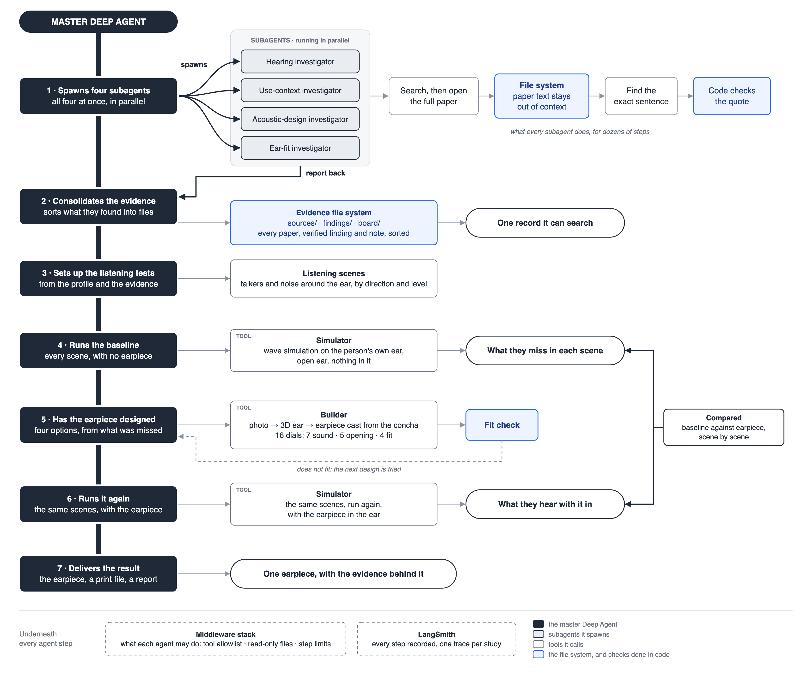

<h1 align="center">Auris</h1>

<p align="center">
  
</p>

We envision a world where hearing aids are cheap and reproducible, without giving up a custom fit.

Auris designs a passive, 3D-printable hearing device for one person's ear.
A user uploads a photo of their ear and enters the results of a hearing test.
Auris reconstructs the ear in 3D, sends research agents to study what that hearing profile and those listening situations call for, and simulates how the person hears with and without a device.
The output is a 3D preview of the earpiece seated in the ear and a printable STL file.
There are no electronics, no battery, and no clinic visit: the device is an acoustic horn shaped to fit one ear.

## LangChain Deep Agent structure

The research side of Auris is built on LangChain's Deep Agents, running on LangGraph and traced in LangSmith.
A deep agent can search the literature, open full papers, find the exact sentence that supports a claim, and keep going for dozens of steps.

| Agent | Built as | What it does | Code |
| --- | --- | --- | --- |
| Research lead | Deep Agent | Spawns the four investigators as its subagents, all at once. Code scripts this dispatch so every investigator receives the same package. | `agents/src/horn_study/research.py` |
| Hearing investigator | Deep Agent, subagent of the lead | Given the user's test results and the evaluator's model, what should the study investigate? | `agents/src/horn_study/research.py` |
| Use-context investigator | Deep Agent, subagent of the lead | What scenarios and tradeoffs follow from this user's activities and priorities? | `agents/src/horn_study/research.py` |
| Acoustic-design investigator | Deep Agent, subagent of the lead | Which supported geometries and parameter variations are worth investigating? | `agents/src/horn_study/research.py` |
| Ear-fit investigator | Deep Agent, subagent of the lead | Given this user's ear and activities, what shell shape, retention, and venting will fit, stay in place, and stay comfortable? | `agents/src/horn_study/research.py` |
| Lead | Deep Agent with a read-only evidence file system | Talks with the user, answers questions from the evidence files, and walks the session through simulation, design, validation, and the report. | `agents/src/horn_study/lead.py` |
| Coordinator | LangChain agent, no tools | Drafts the experiment plan in a full command-line study. Code validates and freezes it. | `agents/src/horn_study/planner.py` |
| Interpreter | LangChain agent, no tools | Explains results that code has already computed. | `agents/src/horn_study/reporting.py` |

What Deep Agents gives us:

- **Subagents.** One lead owns the research and spawns four investigators that run in parallel.
- **A file system.** The full text of every paper is kept in files, out of the agent's context, so an agent searches a paper for exact wording instead of trying to remember it.
  Everything the investigators read and find is sorted into one evidence tree: `sources/`, `findings/`, and `board/`.
- **A middleware stack.** Middleware decides what each agent may do: a tool allowlist, read-only files, and step limits.

Every study is one LangSmith trace, with each investigator, search, and read nested under it.

## Agent architecture

The dark line is the lead Deep Agent and each row is what it directs for that step.
Heavy arrows show it spawning its subagents and their reports coming back.
Dashed arrows show work that returns for another try.

<p align="center">
  
</p>

The order of the lead's steps is fixed in code.
Models do the research, pick the listening scenes, and answer the user.
Code decides the numbers.

Run one study from the command line:

```sh
cd agents
uv sync
cp .env.example .env    # then add your model key
uv run horn-study run examples/requests/dev_with_needs.json
```

Start the lead for the dashboard:

```sh
cd agents
uv run uvicorn horn_study.server:app --port 8010
```

## Customer understanding

Hearing is one of the easiest senses to lose and one of the hardest to live without, and most people who need a hearing aid will never get one.

The World Health Organization projects that by 2050 nearly 2.5 billion people will have some degree of hearing loss, and more than 700 million will require hearing rehabilitation.
It also reports that over 1 billion young adults are at risk of permanent, avoidable hearing loss due to unsafe listening practices.
([WHO, Deafness and hearing loss](https://www.who.int/news-room/fact-sheets/detail/deafness-and-hearing-loss))

Getting a hearing aid can be expensive, and it takes fittings, clinic visits, batteries, and repairs.
Something this important should not be this hard to reach.

Our target user has a mild, high-frequency hearing loss.
A passive device has only a few decibels to give, so it suits people who need a small lift, not people who need a powered aid.

## What it does

1. **Photo to ear.** A phone photo of the ear becomes a 3D ear mesh.
2. **Hearing profile.** The user enters the results of a hearing test.
3. **Research.** Four investigators read the literature on that hearing profile, the user's listening situations, horn acoustics, and ear fit.
4. **Baseline.** Auris simulates the user's listening scenes on their own ear with nothing in it, and measures what they miss.
5. **Design.** An earpiece is cast from the person's own concha with the horn carved inside it, following the outline of their ear opening.
6. **Compare.** The same scenes run again with the earpiece in, and the two runs are compared scene by scene.
7. **Output.** A 3D preview of the earpiece seated in the ear, a printable STL file, and a report.

## Measurable usefulness

One full study on the real acoustic model, run on 14 November 2026 with the template ear and an example sloping hearing loss.
The study scored four designs against the open ear in six listening conditions: clean speech and speech in babble, each at 50, 65, and 80 dB SPL.
All 30 evaluation cases completed.
Scores are HASPI v2, on a scale from 0 to 1.

| Design | Mean change against the open ear | Outcome |
| --- | --- | --- |
| Earpiece with a collector | +0.036 | Selected. Better in four conditions, level with the open ear in the two loud ones. |
| Flush earpiece, no stem | -0.002 | Not eligible: worse than the open ear at 80 dB SPL. |
| Flush earpiece, 5 mm stem | -0.006 | Not eligible: worse than the open ear at 80 dB SPL. |
| Coiled horn, wide throat | -0.012 | Not eligible: worse than the open ear at 80 dB SPL. |

Three of the four designs first proposed were inside every allowed range and still could not be built in that ear.
The test-build step caught all three before anything was scored, and they were corrected in one revision.

The gain is small, and we say so.
The best design helps most with soft speech and roughly matches the open ear at loud speech.

## How we built it

- **Ear reconstruction.** A photo becomes a 3D ear mesh with the AudioEar networks and SAM 2, served by FastAPI.
- **Acoustics.** A 1D transmission-matrix model predicts insertion gain at the eardrum, scored with HASPI v2 speech intelligibility across 32 sampled ear canals, in quiet and in babble noise.
- **Research agents.** A lead Deep Agent and four investigator subagents (hearing, use context, acoustic design, ear fit) on LangGraph and Deep Agents with Claude, reading the literature.
- **Guardrails.** Code, not the model, decides the numbers and the winner.
- **Frontend.** Next.js and three.js for the 3D viewer, Supabase for sign-in.

### The earpiece and its parameters

Every design is test-built and scored.
The builder runs a fit check, because every ear is unique and a design can be inside our allowed dimensions and still not fit.

The earpiece has 16 adjustable parameters:

- 7 that shape the sound
- 5 that set where the opening points and what outline it has
- 4 that determine fit

Five of them (throat, mouth, stem, and the collector's reach and opening) are varied when candidate designs are compared.

## Acoustic and auditory modeling

We use a 1D acoustic model to search earpiece designs quickly.
It treats the earpiece, ear canal, and eardrum as a series of tubular sections, so we can calculate how each design affects sound across 200 frequencies.
Each section of length $L$ and cross-sectional area $S$ relates the pressure $p$ and volume velocity $U$ at its two ends by a transmission matrix:

```math
\begin{bmatrix} p_1 \\ U_1 \end{bmatrix} = \begin{bmatrix} \cos kL & j Z_c \sin kL \\ \frac{j}{Z_c} \sin kL & \cos kL \end{bmatrix} \begin{bmatrix} p_2 \\ U_2 \end{bmatrix}, \qquad Z_c = \frac{\rho c}{S}
```

where $k$ is the wavenumber, including losses to the tube walls.
Multiplying the matrices from the earpiece's mouth to the eardrum gives one matrix for the whole path.
Ending it in the eardrum's impedance $Z_{ED}$ gives the pressure at the eardrum.
We compare that with the same ear left open, which gives the insertion gain:

```math
p_{ED} = \frac{p_{in}}{A + B / Z_{ED}}, \qquad \mathrm{IG}(f) = 20 \log_{10} \left| \frac{p_{ED}^{\,aided}(f)}{p_{ED}^{\,open}(f)} \right|
```

We then narrow our choices by modeling across 32 realistic canals, keeping designs that work well in most or all of them.

A 3D wave simulation checks what the 1D model does not.
We place the user's reconstructed ears on a head shaped from their own photo, which captures how the head and outer ear themselves filter sound.
The simulation steps the linear acoustic equations forward in time on a grid of 1.5 to 3 mm cells, with the head and ears as rigid walls:

```math
\frac{\partial p}{\partial t} = -\rho c^2 \, \nabla \cdot \mathbf{v}, \qquad \frac{\partial \mathbf{v}}{\partial t} = -\frac{1}{\rho} \nabla p
```

We use acoustic reciprocity and simulate a click from each eardrum, which gives each ear's full directional response.
Swapping source and receiver leaves the transfer function unchanged, so the sound radiated outward by the click in direction $\hat{r}$ equals the sound that would reach the eardrum from $\hat{r}$.
We record pressure on a closed surface around the head and project it to the far field with the Kirchhoff-Helmholtz integral:

```math
F(\hat{r}, f) = \oint_S e^{\, jk \, \hat{r} \cdot \mathbf{x}} \left[ jk \, (\hat{r} \cdot \mathbf{n}) \, P(\mathbf{x}) - \frac{\partial P}{\partial n} \right] dS, \qquad H(\hat{r}, f) = \frac{F(\hat{r}, f)}{C(f)}
```

where $C(f)$ is the spectrum of the click.
One run per ear gives $H$ for every direction around the head, and it agrees with direct single-direction simulations within 0.5 dB.

Finally, auditory models turn sound into what a person can actually hear.
We build scenes, such as a conversation or a rave, by placing sound sources around the head.
Each source is filtered through the ear's directional response and the user's hearing test, so sounds at pitches they have lost count for less.
In each band $i$, a source's level at the eardrum and the threshold it must clear are:

```math
E_i = S_i + 20 \log_{10} \left| H_i(\hat{r}) \right|, \qquad D_i = \max\left( Z_i, \; X_i + \mathrm{HL}_i \right)
```

where $S_i$ is the source's band level, $Z_i$ is masking from the other sources, $X_i$ is the internal noise of a normal ear, and $\mathrm{HL}_i$ is the user's hearing loss.
Speech is scored with the Speech Intelligibility Index and HASPI v2:

```math
\mathrm{SII} = \sum_i I_i \, L_i \, \frac{\min\left(\max(E_i - D_i, -15), \, 15\right) + 15}{30}
```

where $I_i$ is how much band $i$ matters for understanding speech and $L_i$ accounts for distortion at high levels.
The benefit of a design is its score with the earpiece minus the open ear's score, averaged over the user's scenes $s$ with weights $w_s$:

```math
\Delta = \frac{\sum_s w_s \left( \mathrm{SII}_s^{\,aided} - \mathrm{SII}_s^{\,open} \right)}{\sum_s w_s}
```

The result is an earpiece design tuned to one person's ear, hearing, and daily life.

## Guardrails

- **Code decides the numbers.** Every score, the ranking, and the selected design are computed in code, never by a model.
- **Quotes are checked.** A research finding only counts if its quoted passage appears, word for word, in the source the agent actually read.
- **No design that makes things worse.** In a study, a design is selected only if it is no worse than the open ear in every listening condition tested, and better overall.
- **Every design is test-built first.** A design that cannot be built in the user's ear is rejected with the reason before anything is scored.
- **Agents hold only the tools they need.** Investigators can search, read, and record. They cannot write files, run commands, or reach the simulator.
- **The evidence is read-only.** The lead can list, read, and search the evidence files, and cannot change them.
- **Only public sources are read.** The reader refuses local and private network addresses.
- **Sign-in.** Users sign in with Google through Supabase.

## Responsible design

- Auris does not diagnose.
  Results are model predictions, not clinical outcomes, and the final report says so and points the user to an audiologist.
- Missing hearing thresholds are never filled in or estimated.
- When there is no photo, the average template ear is used and labelled as not being anyone's ear.
- The acoustic model has not been validated against measurements on a printed device.

## Accomplishments that we're proud of

- An end-to-end pipeline from a phone photo to a printable, personalized earpiece.
- An accessible, passive alternative that can be reproduced without batteries or a clinic.
- A passive device can easily make some sounds harder to hear, so every design is tested against the open ear, and one that is worse in any tested condition is not selected.

## Challenges we ran into

- **A passive device has little to give.** An earpiece that fills the concha removes the ear's own boost around 2 to 4 kHz, so the best designs land close to the open ear, not far above it.
- **In range does not mean buildable.** Designs inside every parameter range still failed to fit a given ear, which is why each one is test-built before it is scored.
- **Reading whole papers.** PubMed Central pages answer automated readers with a browser check, which left agents working from abstracts until we read those articles through the official NCBI API.

## What's next for Auris

- Print an earpiece and measure it, to check the model against a real device.
- Model the needs the simulator cannot test yet, such as retention and comfort during movement.
- Keep the papers the agents have already read, so a new user's research starts from that library.

## Repository layout

| Path | Contents |
| --- | --- |
| [`agents/`](agents/README.md) | Deep Agents research system, the lead and its server, evaluator adapter, events and artifacts for the frontend, LangSmith tracing |
| [`backend/`](backend/README.md) | FastAPI server: ear photo to 3D ear (AudioEar), patient context, acoustic model, 3D in-ear earpiece. Dockerfile included. |
| `frontend/` | The Auris Next.js app: sign-in, dashboard, hearing test, live simulations, and the 3D viewer. |

Run it locally:

```sh
git submodule update --init

# backend, port 8000
cd backend
uv venv -p 3.12 .venv && uv pip install -p .venv -r requirements.txt
.venv/bin/uvicorn app.main:app --port 8000

# agents, port 8010
cd ../agents
uv sync
uv run uvicorn horn_study.server:app --port 8010

# frontend
cd ../frontend
npm install
npm run dev
```

See `backend/README.md` and `agents/README.md` for model weights, keys, and settings.

## End to end functionality

An ear photo and a hearing test go in.
Research, a baseline simulation with no device, earpiece options built for that ear, a second simulation with the chosen earpiece, a report, and a print file come out.
