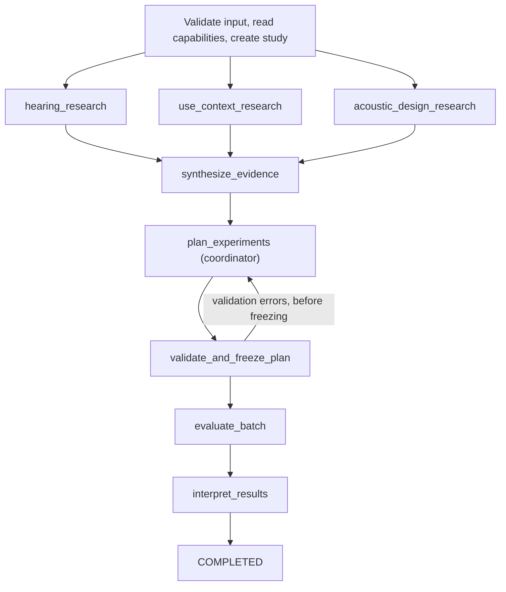

# horn-study: research and experiment-planning agents

This package is the agent workstream for the passive acoustic hearing device project.
It takes a profile with existing hearing-test results and optional needs, researches the question in three parallel branches, forms hypotheses, freezes one finite experiment plan, sends that plan to the team's evaluator, explains the returned results, and stops.

The product starts after hearing testing.
Users supply their existing results.
Nothing here conducts a hearing test, decides whether someone is deaf, or produces a diagnosis.

A study runs once.
A follow-up is a new study that a user has to start.

## Quick start

```bash
cd agents
uv sync
cp .env.example .env        # then fill in the keys

uv run horn-study capabilities                                  # what the evaluator supports
uv run horn-study validate examples/requests/dev_with_needs.json
uv run horn-study run examples/requests/dev_with_needs.json     # one full study
uv run horn-study replay dev_with_needs_001                     # re-emit a recorded study
```

`run` needs a chat model key.
The default model is `anthropic:claude-sonnet-5-5`, so set `ANTHROPIC_API_KEY`.
Any `provider:model` string that LangChain's `init_chat_model` understands works through `HORN_STUDY_MODEL`.
`validate`, `capabilities`, `follow-up` (without `--run`), and `replay` need no keys.

Exit codes: `0` completed, `1` failed, `2` input rejected, `3` configuration problem.

## How a study runs



States: `CREATED -> RESEARCHING -> PLANNING -> PLAN_FROZEN -> EVALUATING -> INTERPRETING -> COMPLETED`, with terminal `FAILED` and `CANCELLED`.

The only cycle is between planning and validation, and it closes before the plan is frozen.
No edge leads from evaluation or interpretation back to planning.

| Phase | Who | Can do | Cannot do |
| --- | --- | --- | --- |
| Research | Three Deep Agents, run concurrently by LangGraph | Search literature, read sources, record findings, read saved source text | Run the evaluator, write files, run shell commands, spawn subagents |
| Planning | Coordinator model with no tools | Propose hypotheses, candidates, scenarios, and a selection rule | Freeze its own plan. Code validates it against capabilities and budget. |
| Evaluation | Bounded runner (code) | Evaluate each frozen spec, retry the identical spec after a transient failure | Change a spec, add a case, turn a failure into a number |
| Interpretation | Model with no tools | Explain the computed comparison, judge hypotheses, suggest follow-ups | Change scores or the selection, run anything |

### What code decides, not a model

- Whether supplied hearing data is usable (`intake.py`).
- Whether a finding is accepted: its source must have been read in this study, and its quoted passage must appear in the text that was read (`research.py`).
- Whether a plan is executable and within budget (`planner.py`).
- Every aggregate, the candidate ranking, and `selected_candidate_id` (`reporting.py`).
- A hypothesis verdict is forced to `inconclusive` when any of its cases did not complete.

## For the frontend

### Starting a study

Send a request shaped like `examples/requests/dev_with_needs.json`.
Call `horn-study capabilities` to learn which frequencies and measurement types the evaluator requires before building the form.
Call `horn-study validate` to pre-check a profile.
A rejected request returns every problem at once and saves nothing:

```json
{
  "accepted": false,
  "issues": [
    {
      "code": "hearing.required_frequency_missing",
      "field": "hearing_profile.measurements",
      "message": "Missing the right ear air conduction threshold at 2000 Hz. Enter it from your existing test results."
    }
  ]
}
```

Request fields that matter:

| Field | Meaning |
| --- | --- |
| `mode` | `personalized` uses the user's own results. `demo` uses a synthetic profile and must be chosen explicitly. |
| `evaluation_mode` | `development_fixture` or `real`. A request for `real` never falls back to the fixture. |
| `start` | The user action that authorizes this one study. `initiated_by` must be `user`. |
| `hearing_profile.measurements[]` | `ear`, `frequency_hz`, `threshold_db_hl` (dB HL), `measurement_type`, `status`. |
| `status` | `measured`, `no_response`, `missing`, or `unreadable`. A marker never carries a numeric threshold. |
| `demo_profile_id` | Name of a synthetic profile from the capabilities. Demo mode only. |
| `needs_profile` | Optional. Without it the study uses the named context `default_everyday_listening`. |
| `budget` | Caps on evaluation cases, parallel evaluations, research calls per agent, retries, plan revisions, and run time. |

Only target-ear measurements of a supported type are used.
Other-ear and unsupported-type values are kept under `retained_but_unused` and never substituted.

### Progress events

Each study appends to `events.jsonl`, one JSON object per line, in strict `sequence` order.
`horn-study run --json` prints the same objects to stdout as they happen.

```json
{
  "study_id": "dev_with_needs_001",
  "sequence": 9,
  "timestamp": "2026-11-14T10:08:25.112173Z",
  "phase": "RESEARCHING",
  "component": "hearing_research",
  "type": "research.finding_added",
  "summary": "A short user-facing sentence.",
  "finding_ids": ["hearing-F1"],
  "hypothesis_ids": [],
  "candidate_ids": [],
  "experiment_ids": [],
  "artifacts": [],
  "trace": {"run_id": "...", "project": "...", "tracing_enabled": true},
  "data": {"source_id": "S1", "source_url": "https://...", "source_title": "..."},
  "replay": false
}
```

Event types: `study.started`, `study.state_changed`, `research.agent_started`, `research.source_read`, `research.finding_added`, `research.agent_completed`, `research.agent_failed`, `hypothesis.created`, `plan.revision_requested`, `plan.frozen`, `experiment.started`, `experiment.retried`, `experiment.completed`, `experiment.failed`, `report.completed`, `study.completed`, `study.failed`, `study.cancelled`.

Events carry summaries and IDs, not model reasoning and not binary assets.

### Artifacts

Each study gets its own directory under `studies/<study_id>/` (override with `--studies-dir` or `HORN_STUDY_DIR`).
An existing study is never overwritten.

| File | Contents |
| --- | --- |
| `request.json` | The original request, its normalized form, the evaluator hearing input, and the study context |
| `capabilities.json` | The evaluator capability snapshot the plan was validated against |
| `research.json` | Branch outcomes, accepted findings, and the sources that were read (URL, title, hash, retrieval time) |
| `plan.json` | The frozen plan: hypotheses, candidates, every experiment spec, selection rule, needs coverage, `plan_hash` |
| `events.jsonl` | Ordered event history |
| `experiment_results.json` | One record per frozen spec: the evaluator's raw result, attempts, cache use, issues |
| `results.json` | The frontend-ready document: state, profile, evidence, plan, per-case results, report, selection |

In `results.json`:

- `selected_candidate_id` is a candidate ID, or `null` when no selection is justified. It is never an array index.
- `selected_candidate` is that candidate's record, with its geometry family and parameters.
- `experiments[]` lists every evaluation case with its `experiment_id`, `candidate_id`, scenario, outcome, metrics, and asset references.
- `report.candidates[]` has the per-candidate aggregates, eligibility, reasons, and rank.
- `report.needs[]` sorts each user need into `addressed`, `evaluated_unsuccessfully`, or `untested`.
- `report.follow_up_proposals[]` are suggestions only.
- `result_label` and `fixture_notice` say whether the numbers are fixture output. Show them.

### Follow-ups and replay

```bash
uv run horn-study follow-up dev_with_needs_001 FU1 --study-id dev_refine_002          # print the new request
uv run horn-study follow-up dev_with_needs_001 FU1 --study-id dev_refine_002 --run    # start it
```

The new study has its own ID and directory and links back through `parent_study_id`.
The parent's files are read, not changed.
`horn-study replay <study_id>` re-emits recorded events with `"replay": true` and runs nothing.

## For the evaluator owner

The agents reach numerical code through two calls only:

```python
get_evaluator_capabilities() -> dict        # or EvaluatorCapabilities
evaluate_experiment(spec: dict) -> dict     # or ExperimentResult
```

Point the workflow at the real implementation with `HORN_STUDY_REAL_EVALUATOR=package.module:attribute`.
The attribute can be a module, an object, a class, or a zero-argument factory that provides both functions.
`tests/fake_real_evaluator.py` is a complete minimal example that takes and returns plain dicts.

Capabilities declare the geometry families and parameter bounds, baselines, required hearing frequencies and measurement types, scenarios, metrics with units and direction, canal configurations, the calibration convention, seed support, fidelity levels, output assets, and explicitly unsupported requirements.
See `EvaluatorCapabilities` in `src/horn_study/contracts.py`, or run `horn-study capabilities` for a filled-in example.
The planner can only propose what the capabilities declare.

`evaluate_experiment` receives one spec: `experiment_id`, `candidate_id`, `candidate_kind`, `family_id` or `baseline_id`, `parameters`, `hearing_input` (the supplied target-ear measurements, unmodified), `scenario_id`, `canal_config_id`, `ear_mesh_ref`, `seed`, `fidelity`, `calibration_ref`, and `spec_hash`.

The result must echo `experiment_id`, `candidate_id`, and `spec_hash`, and report the same `evaluator_version` and `kind` as the capabilities.
Metrics use the declared names and units.
A result that does not match its spec is recorded as `invalid` and excluded from the comparison.
Extra fields in results and capabilities are preserved.

To request a retry of the identical spec, return `status: "failed"` with `error.transient: true`, or raise `horn_study.evaluator_adapter.TransientEvaluatorError`.
Any other failure is recorded once as a failed case.

The adapter does not normalize levels or rescale outputs.
The amplitude and calibration convention is defined by the evaluator and named by `calibration_ref`.

### The development fixture

`evaluation_mode: "development_fixture"` uses a deterministic placeholder with the same contract.
It is not a simulation.
Its metrics are prefixed `fixture_`, every result carries `provenance.kind = "development_fixture"`, and reports are labeled "Development fixture output. Not simulation results."

## LangSmith tracing

Set `LANGSMITH_TRACING=true` and `LANGSMITH_API_KEY` (plus `LANGSMITH_PROJECT`, and `LANGSMITH_ENDPOINT` outside the US region).
Each study is one root trace named `study <study_id>`, with these children:

- `hearing_research`, `use_context_research`, `acoustic_design_research`: each agent run with its model calls and tool calls.
- `synthesize_evidence`, `plan_experiments` (the `study_coordinator` run), `validate_and_freeze_plan`.
- `evaluate_batch`: one `evaluate_experiment` run per attempt, tagged with `experiment_id`, `candidate_id`, `spec_hash`, `plan_hash`, `attempt`, and `evaluator_version`.
- `interpret_results`: the `results_interpreter` run.

The root run ID is in every event's `trace.run_id`.

Traces and model prompts include the supplied hearing thresholds and needs text.
Asset files are passed as references, never as content.

## Research sources

Search queries go to OpenAlex and Europe PMC.
Sources are fetched over HTTP, and PubMed records are read through NCBI E-utilities.
No key is required.
OpenAlex without a key shares a small daily allowance per network, so set `OPENALEX_API_KEY` at an event.
Investigators are told to keep user data out of queries.

## Development

```bash
uv run pytest          # no network or keys needed
uv run ruff check .
uv run ruff format .
uv run pyright
```

Tests drive the real workflow with a scripted stand-in model and offline sources.

| Guarantee | Test |
| --- | --- |
| Missing or unusable results are rejected before anything runs | `test_intake.py`, `test_invalid_input_is_rejected_before_anything_is_saved_or_evaluated` |
| No silent demo data, other-ear data, or invented thresholds | `test_intake.py` |
| Three research branches overlap | `test_three_research_branches_overlap_and_return_identifiable_evidence` |
| Findings need a read source and a verbatim passage | `test_research.py` |
| Investigators and the interpreter cannot reach the evaluator | `test_investigators_hold_evidence_tools_only`, `test_the_interpreter_cannot_change_the_selection_or_run_anything` |
| Plans respect capabilities, controls, and budget | `test_planner.py` |
| The plan is frozen before any result, and only its cases run | `test_the_plan_is_frozen_before_any_result_and_only_its_cases_run` |
| Retries repeat the identical case and are bounded | `test_runner.py`, `test_transient_failures_retry_only_the_identical_case` |
| Failed cases cannot help a design win, and no winner is forced | `test_a_design_with_a_failed_case_cannot_win`, `test_no_winner_is_forced_when_every_design_fails` |
| Reported numbers are the evaluator's numbers | `test_reported_numbers_are_the_evaluators_numbers` |
| No path from results back to planning or evaluation | `test_nothing_leads_from_results_back_to_planning_or_evaluation` |
| A follow-up runs nothing until requested, and keeps the parent record | `test_a_suggested_follow_up_causes_no_evaluation_until_requested`, `test_a_follow_up_is_a_new_study_and_the_parent_record_is_kept` |
| The trace shows branches, planning, evaluation attempts, and the report | `test_the_trace_exposes_branches_planning_evaluation_and_report` |

## Module map

| Module | Responsibility |
| --- | --- |
| `contracts.py` | Typed request, capability, finding, plan, result, report, and state models |
| `intake.py` | Input validation and normalization against evaluator capabilities |
| `sources.py` | Literature search, source reading, passage selection, quote verification |
| `research.py` | The three investigators, their tools, budget, and evidence ledger |
| `planner.py` | Coordinator prompt, plan validation, deterministic expansion, freezing |
| `evaluator_adapter.py` | Evaluator protocol, real-evaluator loader, labeled development fixture |
| `runner.py` | Bounded execution, identical retries, result checks, evaluation cache |
| `reporting.py` | Aggregation, selection rule, needs outcomes, interpretation, report |
| `workflow.py` | LangGraph wiring, state machine, artifacts, terminal handling |
| `events.py` | Event schema, ordered event bus, artifact store |
| `followup.py` | Building a user-requested follow-up study from a saved one |
| `llm.py` | Model selection from the environment |
| `cli.py` | Command line entry point |
