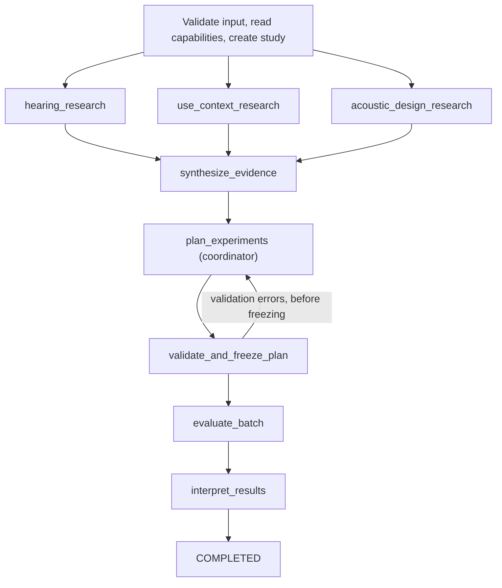

# horn-study: research and experiment-planning agents

This package is the agent workstream for the passive acoustic hearing device project.
It takes a profile with existing hearing-test results and optional needs, researches the question in three parallel branches, forms hypotheses, freezes one finite experiment plan, sends that plan to the team's evaluator, explains the returned results, and stops.

The product starts after hearing testing.
Users supply their existing results.
Nothing here conducts a hearing test, decides whether someone is deaf, or produces a diagnosis.

A study runs once.
A follow-up is a new study that a user has to start.

## Quick start

```bash
cd agents
uv sync
cp .env.example .env        # then fill in the keys

uv run horn-study capabilities                                  # what the evaluator supports
uv run horn-study validate examples/requests/dev_with_needs.json
uv run horn-study run examples/requests/dev_with_needs.json     # one full study
uv run horn-study replay dev_with_needs_001                     # re-emit a recorded study
```

`run` needs a chat model key.
The default model is `anthropic:claude-sonnet-5-5`, so set `ANTHROPIC_API_KEY`.
Any `provider:model` string that LangChain's `init_chat_model` understands works through `HORN_STUDY_MODEL`.
`validate`, `capabilities`, `follow-up` (without `--run`), and `replay` need no keys.

Exit codes: `0` completed, `1` failed, `2` input rejected, `3` configuration problem.

## How a study runs



States: `CREATED -> RESEARCHING -> PLANNING -> PLAN_FROZEN -> EVALUATING -> INTERPRETING -> COMPLETED`, with terminal `FAILED` and `CANCELLED`.

The only cycle is between planning and validation, and it closes before the plan is frozen.
No edge leads from evaluation or interpretation back to planning.

| Phase | Who | Can do | Cannot do |
| --- | --- | --- | --- |
| Research | Three Deep Agents, run concurrently by LangGraph | Search literature, read sources, record findings, read saved source text | Run the evaluator, write files, run shell commands, spawn subagents |
| Planning | Coordinator model with no tools | Propose hypotheses, candidates, scenarios, and a selection rule | Freeze its own plan, skip the coverage the evaluator requires, or relax the per-scenario rule. Code validates the plan against capabilities and budget. |
| Evaluation | Bounded runner (code) | Evaluate each frozen spec, retry the identical spec after a transient failure | Change a spec, add a case, turn a failure into a number |
| Interpretation | Model with no tools | Explain the computed comparison, judge hypotheses, suggest follow-ups | Change scores or the selection, run anything |

### What code decides, not a model

- Whether supplied hearing data is usable (`intake.py`).
- Whether a finding is accepted: its source must have been read in this study, and its quoted passage must appear in the text that was read (`research.py`).
- Whether a plan is executable and within budget (`planner.py`).
- Whether a plan covers what the evaluator requires of every study: enough scenarios, and at least one of each required kind (`planner.py`).
- Every aggregate, the candidate ranking, and `selected_candidate_id` (`reporting.py`).
- A hypothesis verdict is forced to `inconclusive` when any of its cases did not complete.

### The selection rule

The rule is frozen with the plan as `selection_rule` and applied by code in `reporting.py`.
A design is eligible only if all of these hold:

- It completed every planned case.
- It meets every constraint in the plan.
- In every scenario of the plan, its primary-metric result is not worse than the reference control's result in that same scenario.
- Its primary-metric mean over all cases is better than the control's.

The per-scenario check is always on.
The coordinator cannot turn it off, and `selection_rule.require_not_worse_than_reference_in_every_scenario` is always `true`.
"Not worse" allows for metric noise: a design may fall short of the control in a scenario by at most `selection_rule.scenario_tolerance`.
That tolerance is the primary metric's declared `resolution`, copied into the plan when it is built, and it is 0 when the evaluator declares none.
A design that only equals the control in a scenario, for example where both sit at the metric's ceiling, is not disqualified by that scenario.
It still has to beat the control on the mean over all cases.
With several canal configurations or seeds, a scenario is compared on its mean over that scenario's cases.
A scenario where either side is missing a case is never counted as "not worse".
Eligible designs are ranked by improvement over the control, then by the plan's tie-breakers.
When no design is eligible, `selected_candidate_id` is `null` and the explanation names the scenarios each design lost in.

## For the frontend

### Starting a study

Send a request shaped like `examples/requests/dev_with_needs.json`.
Call `horn-study capabilities` to learn which frequencies and measurement types the evaluator requires before building the form.
Call `horn-study validate` to pre-check a profile.
A rejected request returns every problem at once and saves nothing:

```json
{
  "accepted": false,
  "issues": [
    {
      "code": "hearing.required_frequency_missing",
      "field": "hearing_profile.measurements",
      "message": "Missing the right ear air conduction threshold at 2000 Hz. Enter it from your existing test results."
    }
  ]
}
```

Request fields that matter:

| Field | Meaning |
| --- | --- |
| `mode` | `personalized` uses the user's own results. `demo` uses a synthetic profile and must be chosen explicitly. |
| `evaluation_mode` | `development_fixture` or `real`. A request for `real` never falls back to the fixture. |
| `start` | The user action that authorizes this one study. `initiated_by` must be `user`. |
| `hearing_profile.measurements[]` | `ear`, `frequency_hz`, `threshold_db_hl` (dB HL), `measurement_type`, `status`. |
| `status` | `measured`, `no_response`, `missing`, or `unreadable`. A marker never carries a numeric threshold. |
| `demo_profile_id` | Name of a synthetic profile from the capabilities. Demo mode only. |
| `needs_profile` | Optional. Without it the study uses the named context `default_everyday_listening`. |
| `budget` | Caps on evaluation cases, parallel evaluations, research calls per agent, retries, plan revisions, and run time. |

Only target-ear measurements of a supported type are used.
Other-ear and unsupported-type values are kept under `retained_but_unused` and never substituted.

`budget.max_evaluation_cases` must fit the smallest study the evaluator accepts: the control and one design in each of its `minimum_scenarios`.
A smaller budget is rejected with the code `budget.below_required_coverage` before anything runs.

### Progress events

Each study appends to `events.jsonl`, one JSON object per line, in strict `sequence` order.
`horn-study run --json` prints the same objects to stdout as they happen.

```json
{
  "study_id": "dev_with_needs_001",
  "sequence": 9,
  "timestamp": "2026-11-14T10:08:25.112173Z",
  "phase": "RESEARCHING",
  "component": "hearing_research",
  "type": "research.finding_added",
  "summary": "A short user-facing sentence.",
  "finding_ids": ["hearing-F1"],
  "hypothesis_ids": [],
  "candidate_ids": [],
  "experiment_ids": [],
  "artifacts": [],
  "trace": {"run_id": "...", "project": "...", "tracing_enabled": true},
  "data": {"source_id": "S1", "source_url": "https://...", "source_title": "..."},
  "replay": false
}
```

Event types: `study.started`, `study.state_changed`, `research.agent_started`, `research.source_read`, `research.finding_added`, `research.agent_completed`, `research.agent_failed`, `hypothesis.created`, `plan.revision_requested`, `plan.frozen`, `experiment.started`, `experiment.retried`, `experiment.completed`, `experiment.failed`, `report.completed`, `study.completed`, `study.failed`, `study.cancelled`.

Events carry summaries and IDs, not model reasoning and not binary assets.

### Artifacts

Each study gets its own directory under `studies/<study_id>/` (override with `--studies-dir` or `HORN_STUDY_DIR`).
An existing study is never overwritten.

| File | Contents |
| --- | --- |
| `request.json` | The original request, its normalized form, the evaluator hearing input, and the study context |
| `capabilities.json` | The evaluator capability snapshot the plan was validated against |
| `research.json` | Branch outcomes, accepted findings, and the sources that were read (URL, title, hash, retrieval time) |
| `plan.json` | The frozen plan: hypotheses, candidates, every experiment spec, selection rule, needs coverage, `plan_hash` |
| `events.jsonl` | Ordered event history |
| `experiment_results.json` | One record per frozen spec: the evaluator's raw result, attempts, cache use, issues |
| `results.json` | The frontend-ready document: state, profile, evidence, plan, per-case results, report, selection |

In `results.json`:

- `selected_candidate_id` is a candidate ID, or `null` when no selection is justified. It is never an array index.
- `selected_candidate` is that candidate's record, with its geometry family and parameters.
- `experiments[]` lists every evaluation case with its `experiment_id`, `candidate_id`, scenario, outcome, metrics, and asset references.
- `report.candidates[]` has the per-candidate aggregates, eligibility, reasons, and rank.
- `report.candidates[].primary_metric_by_scenario[]` has one entry per scenario of the plan, in plan order, for the primary metric.
  Each entry has `scenario_id`, `mean` and `reference_mean` (the candidate's and the reference control's mean over that scenario's cases), `n_completed`, `n_planned`, `difference_from_reference`, and `standing`.
- `difference_from_reference` is signed so that positive means better than the control, whichever direction the metric runs.
  It is `null` unless both the candidate and the control completed every case in that scenario.
- `standing` is `better`, `within_tolerance`, `worse`, or `not_compared`.
  A design with any `worse` scenario is not eligible, and its `ineligibility_reasons` name the scenario and both numbers.
- `plan.selection_rule.scenario_tolerance` is the tolerance behind `standing`, in the primary metric's unit.
- `report.needs[]` sorts each user need into `addressed`, `evaluated_unsuccessfully`, or `untested`.
- `report.follow_up_proposals[]` are suggestions only.
- `result_label` and `fixture_notice` say whether the numbers are fixture output. Show them.

### Follow-ups and replay

```bash
uv run horn-study follow-up dev_with_needs_001 FU1 --study-id dev_refine_002          # print the new request
uv run horn-study follow-up dev_with_needs_001 FU1 --study-id dev_refine_002 --run    # start it
```

The new study has its own ID and directory and links back through `parent_study_id`.
The parent's files are read, not changed.
`horn-study replay <study_id>` re-emits recorded events with `"replay": true` and runs nothing.

## For the evaluator owner

The agents reach numerical code through two calls only:

```python
get_evaluator_capabilities() -> dict        # or EvaluatorCapabilities
evaluate_experiment(spec: dict) -> dict     # or ExperimentResult
```

Point the workflow at the real implementation with `HORN_STUDY_REAL_EVALUATOR=package.module:attribute`.
The attribute can be a module, an object, a class, or a zero-argument factory that provides both functions.
`tests/fake_real_evaluator.py` is a complete minimal example that takes and returns plain dicts.
The team's real evaluator is `horn_study.hornsim_evaluator`, described below.

Capabilities declare the geometry families and parameter bounds, baselines, required hearing frequencies and measurement types, scenarios, metrics with units and direction, canal configurations, the calibration convention, seed support, fidelity levels, output assets, and explicitly unsupported requirements.
See `EvaluatorCapabilities` in `src/horn_study/contracts.py`, or run `horn-study capabilities` for a filled-in example.
The planner can only propose what the capabilities declare.

Capabilities also say what every study must cover and how to spend its budget.
All four fields are optional:

| Field | Meaning | Default |
| --- | --- | --- |
| `required_scenario_tags` | A plan must include at least one scenario carrying each listed tag. Tags are the ones on `scenarios[].tags`. | none |
| `minimum_scenarios` | A plan must include at least this many scenarios. | 1 |
| `planning_notes` | Short sentences the coordinator reads before it plans, such as which of candidates and scenarios is the expensive one. | none |
| `metrics[].resolution` | The smallest difference in that metric that is meaningful, in the metric's unit. | 0 |

A draft that misses the coverage is sent back to the coordinator, with the scenarios it can add, before anything is frozen.
Capabilities whose coverage no plan could meet are rejected when they are read: a required tag that no scenario carries, or a minimum above the number of scenarios.
The primary metric's `resolution` becomes the per-scenario tolerance of the selection rule.
Set it to the metric's run-to-run noise, because a design may fall that far below the unaided control in a scenario and still be selected.

`evaluate_experiment` receives one spec: `experiment_id`, `candidate_id`, `candidate_kind`, `family_id` or `baseline_id`, `parameters`, `hearing_input` (the supplied target-ear measurements, unmodified), `scenario_id`, `canal_config_id`, `ear_mesh_ref`, `seed`, `fidelity`, `calibration_ref`, and `spec_hash`.

The result must echo `experiment_id`, `candidate_id`, and `spec_hash`, and report the same `evaluator_version` and `kind` as the capabilities.
Metrics use the declared names and units.
A result that does not match its spec is recorded as `invalid` and excluded from the comparison.
Extra fields in results and capabilities are preserved.

To request a retry of the identical spec, return `status: "failed"` with `error.transient: true`, or raise `horn_study.evaluator_adapter.TransientEvaluatorError`.

An evaluator may also provide an optional third call, `check_buildable(spec)`.
It returns `None` when the candidate can be built, or `{"code", "message"}` with the reason when it cannot, and it never scores anything.
When it exists, plan validation test-builds every design before the plan is frozen and sends each rejection back to the coordinator to correct.
This catches designs whose dials are each in range but do not fit together, which would otherwise fail in every scenario after the plan was locked.
A rejected draft uses one of the plan's `max_plan_revisions`, so a request for a real evaluator should allow a few more than the default of 2.
Any other failure is recorded once as a failed case.

The adapter does not normalize levels or rescale outputs.
The amplitude and calibration convention is defined by the evaluator and named by `calibration_ref`.

### The hornsim evaluator

`horn_study.hornsim_evaluator` connects `evaluation_mode: "real"` to the backend's `hornsim` pipeline (see `../backend/HORNSIM.md`).
It builds a 3D device in the configured ear, models its insertion gain with the 1D acoustic model, applies that gain to the speech clips, and scores them with HASPI v2 using the supplied audiogram.
It can build two devices: the coiled aid of `hornsim.aid` and the in-concha earpiece of `hornsim.earpiece`.
Both go through the same scenarios, canal sample, HASPI call, and unaided control, so one study can compare them.

What the model says about the coiled aid, so results are read correctly:
A narrow throat feeding the ear canal is a low-pass filter, so the hornsim default (throat 1 mm^2) sits 10 to 25 dB below the open ear above 500 Hz and scores worse than no device.
Widening the throat is what brings 1 to 4 kHz back, and a wide bore is routed as a short funnel with no vent.
Even the widest buildable bore stays about 6 dB below the open ear at 2 to 4 kHz, because the shell fills the concha and removes its natural boost.
On the template ear with the example sloping loss, the widest bores score above the unaided control for soft speech, about level with it at 65 dB SPL, and below it at 80 dB SPL, where the listener hears the highs unaided and the device cuts them.
Expect the best designs to land near the unaided control, not far above it.

hornsim needs torch and pyclarity, which this environment does not install.
Every numerical step therefore runs in the backend's own interpreter through `bridges/hornsim_bridge.py`, one short process per step, with JSON on stdin and stdout.
The bridge calls hornsim's functions and adds no numerics of its own.

Set it up once:

```bash
git submodule update --init                    # from the repository root
cd backend
uv venv -p 3.12 .venv && uv pip install -p .venv -r requirements.txt
```

The photo pipeline and its weights are not needed.
If there is no ear mesh from a photo yet, write AudioEar's average ear as a stand-in:

```bash
echo '{"out": "data/template_ear/ear.ply", "height_mm": 62, "side": "right"}' \
  | PYTHONPATH=. .venv/bin/python ../agents/bridges/hornsim_bridge.py template-ear
```

That mesh is a template, not anyone's ear.
A provenance note is saved beside it and repeated in the capabilities and in every result.

Then set these in `agents/.env`:

| Variable | Meaning |
| --- | --- |
| `HORN_STUDY_REAL_EVALUATOR` | `horn_study.hornsim_evaluator` |
| `HORNSIM_BACKEND_DIR` | The repository's `backend/` directory. Required. |
| `HORNSIM_EAR_MESH` | The patient's ear mesh in mm, in AudioEar's 2,800-vertex topology (`ear.ply` from `earrecon`, or the template). Required. |
| `HORNSIM_WORK_DIR` | Where patient contexts, built devices, and each ear's earpiece limits are kept and reused. Required. |
| `HORNSIM_PYTHON` | The backend interpreter. Defaults to `<backend>/.venv/bin/python`. |
| `HORNSIM_EAR_HEIGHT_MM` | Optional. Rescales the mesh to this ear height. Unset means the mesh is used at its own size. |
| `HORNSIM_BRIDGE_TIMEOUT_SECONDS` | Optional. Time allowed per bridge step. Defaults to 1800. |

Relative paths are resolved from the directory the command runs in.
A missing or wrong value stops the run with exit code `3` and names every variable that needs attention.

Run a real study:

```bash
uv run horn-study capabilities --evaluation-mode real
uv run horn-study validate examples/requests/real_with_needs.json
uv run horn-study run examples/requests/real_with_needs.json
```

What it declares, all read from the installed backend each time a study starts:

- The geometry family `spiral_exponential_horn`, with the parameters and bounds of `AidDesign` in `backend/app/main.py`: throat 0.3 to 31 mm^2, mouth 2 to 200 mm^2, vent 0 to 2.5 mm, wall 0.4 to 2 mm, path 20 to 300 mm, and tip clearance 0.2 to 1.5 mm.
  A vent of 0 means no vent, which a throat above about 3 mm^2 needs because there is no room for a vent beside it in the canal tip.
  The largest throat that passes the canal tip is `pi * (canal diameter / 2 - tip clearance - wall)^2`: 20.4 mm^2 at the defaults and 31 mm^2 with the smallest tip clearance and wall.
  The bounds are what some ear can hold, so a design can be in bounds and still not fit the configured ear.
- The geometry family `concha_horn_earpiece`, described in the next section.
  It is declared only when the backend has `hornsim.earpiece` and the configured ear can hold an earpiece.
  Otherwise the capabilities carry the reason under `earpiece.reason` and the spiral family stands alone.
- One baseline, `unaided`: a flat 0 dB response sent through the same clips, levels, and HASPI call as the designs.
- Scenarios for each clip type (clean speech, speech in babble) at each presentation level in `hornsim/defaults.yaml`.
  Every scenario is the mean over its clips: three clean sentences, or four sentences in babble.
  HASPI on a single two-second clip swings too much with level to rank designs, so per-clip values are kept for inspection only.
- One calibration, `hornsim-reference-at-65-db-spl-v2`: HASPI's clean reference always stands for 65 dB SPL and the presentation level scales only what the listener hears.
  Results made under the earlier `hornsim-reference-rms1-at-level-v1` convention are not comparable at 50 and 80 dB SPL.
- Metrics: `haspi_v2_mean`, `haspi_v2_worst_canal`, `haspi_v2_improvement_over_unaided`, four insertion gain band averages, `bore_length_mm`, and `protrusion_mm`.
  The last two are informational.
  `protrusion_mm` is how far the print stands out past the plane of the concha rim, measured the same way for both families, and 0 for the control.
  A plan can cap it with a selection constraint when the user wants a small or discreet device, which is why `compact_size` is not listed as unsupported while the earpiece is declared.
- Required thresholds at 250, 500, 1000, 2000, 4000, and 6000 Hz, the six frequencies HASPI v2 uses.
  pyclarity would interpolate a missing one, so a request without all six is rejected instead.
  The placeholder audiogram in `defaults.yaml` is never used.
- No seeds.
  hornsim fixes HASPI's internal noise with one seed so that scores repeat.
- `evaluator_version` is `hornsim-<commit>`, the last commit that touched `backend/hornsim`.

What to expect when it runs:

- The patient context is built once per ear mesh and audiogram (about three minutes) and each design once per family and set of design numbers (about ten seconds for a coiled aid, about three for an earpiece), however many scenarios or threads ask for it.
  Both are kept in `HORNSIM_WORK_DIR` and reused by later studies.
- The first time capabilities are read for an ear, two probe earpieces are built to find its limits (about five seconds).
  The answer is kept under `HORNSIM_WORK_DIR/ears` and reused.
- Scoring one scenario takes 20 to 40 seconds.
- A design that cannot be routed in the ear comes back as `status: "failed"` with `error.code: "geometry_does_not_fit"` and hornsim's reason, never as a score.
  The reasons are a throat too wide for the canal tip, no bore route that fits the concha, and a vent that cannot keep the minimum wall to the bore.
- hornsim itself now refuses a vent that would cut into the bore.
  The adapter still checks `vent_wall_to_bore_mm` in `design.json` and reports `error.code: "vent_intersects_bore"` if an older backend lets one through, because the acoustic model assumes separate channels.
- An earpiece that `hornsim.earpiece` rejects comes back the same way, with every reason the builder gave in `error.message` and, unchanged, under `build_reasons`.
  Values the builder does not accept at all come back as `status: "unsupported"` with `error.code: "bad_parameter"`, and a crash in either builder as `error.code: "build_failed"`.
- Results carry references to `design.json`, `aid.glb`, `aid_in_ear.glb`, `aid_print.stl`, `acoustics.json`, and `references.json`, plus hornsim's own per-clip scores and its unaided and ceiling references.
  For an earpiece the built files are `design.json` (the builder's report), `earpiece.glb`, `earpiece_in_ear.glb`, `earpiece_print.stl`, `preview.png`, and an `acoustics.json` that records exactly what the acoustic model was given.
- The bridge process does not inherit model or tracing keys.

`tests/test_hornsim_evaluator.py` covers the adapter with the bridge stubbed.
Its last two tests run the real pipeline, one per family, and are skipped unless `HORNSIM_BACKEND_DIR`, `HORNSIM_EAR_MESH`, and `HORNSIM_WORK_DIR` are set.

#### The in-concha earpiece family

`concha_horn_earpiece` is the device of `backend/hornsim/earpiece.py`: a seat cast from the concha with the horn carved inside it, an optional soft stem into the canal, and an optional collector that carries the horn outward past the faceplate.
It has no vent.
It is the only family whose opening can be larger than the concha opening.
A study that selects one names its parameters `throat_mm2` and `mouth_mm2`, which is what `horn-study earpiece` locks when it shapes the final print.

Every bound is read from the backend when capabilities are read.
The values below are the template ear's.

| Parameter | Bounds | Where they come from |
| --- | --- | --- |
| `throat_mm2` | 7 to 60 mm^2 | `earpiece.PARAMS`. With a stem the bore runs inside it, so the throat can be at most 27.3 mm^2 unless `canal_stem_mm` is 0. That limit is this ear's, from `target.earpiece_boxes`. |
| `mouth_mm2` | 20 to 304.7 mm^2 | The mouth on the faceplate. The lower bound is the builder's. The upper bound is this ear's: 0.95 of the largest mouth its concha opening holds, from `target.earpiece_boxes`, rounded down to 0.1. The builder's own range reaches 1500. |
| `canal_stem_mm` | 0 to 8 mm | `earpiece.PARAMS`. 0 means no stem. |
| `collector_reach_mm` | 0 to 35 mm | `earpiece.MAX_REACH_MM`. 0 means no collector. |
| `collector_mouth_mm2` | 0 to 2827.4 mm^2 | The area of the largest section radius, 30 mm, that `earpiece.validate_collector` accepts. 0 means no collector. |

How a study asks for a collector:
The builder takes a collector as a spine and a cross-section at each spine point, which is not a number a plan can hold.
A study sets two numbers instead, and the adapter writes them into the builder's format as one straight section.
The spine has one point, `collector_reach_mm` out from the mouth centre along the faceplate normal.
The builder rounds off the end of the path, so the rim it builds sits about 1 mm closer than that.
Its cross-section is round, with area `collector_mouth_mm2`.
The builder blends the mouth outline on the faceplate into that circle.
Both numbers 0 means no collector and a flush faceplate.
One without the other is refused as `bad_parameter`.

What a study cannot ask for:
A bent or scooped collector, one that faces the talker, a cross-section that is not round, more than one section, a hood, a vent, or any other dial of the builder.
The talker direction, mouth outline, flare shape, wall, removal tab, and fit size stay at the builder's defaults, which the capabilities list under `earpiece.fixed_dials`.
A faceplate mouth larger than the ear allows cannot be asked for either: the planner rejects it against the declared bound, and a spec that reaches the evaluator anyway is built, rejected by the builder with `mouth_fit`, and returned as a failed case.

The bounds are checked one dial at a time, so a design can be in bounds and still be rejected.
On the template ear a 304.7 mm^2 mouth builds with a 60 mm^2 throat and no stem, and fails with a 27 mm^2 throat and a stem because the flare breaks through the seat wall.

How it is scored:
The builder reports the area along the bore it actually cut, about every millimetre.
That profile goes through the profile door of `hornsim.acoustics`, from the collector's rim (or the faceplate mouth) to the seat floor, followed by the stem as a tube at the throat area.
The patient's `ear_params` are passed, so the open-ear reference is this ear's own concha.
The canals, clips, levels, HASPI call, and unaided control are the ones the spiral family uses.
If a backend's builder reports no area profile, the dial door is used with the same settings, and a collector cannot be scored.
A profile that stops short of the opening the builder reports is refused with `build_failed`, because the model would be scoring a smaller mouth than was built.

The settings are the unified defaults with one exception.
The whole canal is each canal sample plus 9 mm, the coiled aid's tip length, which is the canal the spiral family's open ear already has.
Both families are then compared with the same open canal, and a shorter stem leaves more of it behind the piece.
With the field left unset, the profile door would give each stem length a different canal: a design with no stem would be compared with an ear whose canal is 9 mm shorter than the one the coiled aid is compared with.

What the acoustic model does not see:

- The direction a collector faces, and any directional gain.
  The model is one-dimensional.
- The shape of a cross-section.
  Only its area counts.
- The head and pinna around a protruding collector.
- The open neck between the seat floor and the canal opening.
  The builder reports its height as `seat_floor_mm` (3 to 5.5 mm on the template ear), and with a stem the bore runs through it.
  Adding that length to the default earpiece lowers its modelled gain by about 1.8 dB at 2 to 4 kHz and raises it by 1 dB at 1 to 2 kHz.
  Designs with no stem are not affected.
- The removal tab, and any leak around the seat, which is treated as sealed.

One more difference between the families:
The spiral family's insertion gain is relative to an average concha resonance, as before, and the earpiece's is relative to this ear's concha.
On the earpieces tried here the two references differ by up to 0.9 dB per band.

What the model says about the earpiece on the template ear, with the example sloping loss (15, 20, 30, 45, 55, 55 dB HL):
These are model outputs from built designs, not measurements on a printed device.
Each cell is `haspi_v2_mean`, with the difference from the unaided control in brackets.
The selection rule tolerates a shortfall of 0.02 in a scenario.

| Design (throat, mouth, stem, collector) | Clean 50 | Clean 65 | Clean 80 | Babble 50 | Babble 65 | Babble 80 | Mean |
| --- | --- | --- | --- | --- | --- | --- | --- |
| Unaided control | 0.571 | 0.776 | 0.988 | 0.348 | 0.576 | 0.735 | 0.666 |
| Builder defaults (27, 150, 5 mm, none) | 0.614 (+0.044) | 0.783 (+0.007) | 0.934 (-0.054) | 0.358 (+0.009) | 0.589 (+0.013) | 0.679 (-0.056) | 0.660 |
| Wide throat (60, 150, 0, none) | 0.573 (+0.002) | 0.778 (+0.002) | 0.979 (-0.009) | 0.349 (+0.001) | 0.580 (+0.003) | 0.698 (-0.036) | 0.659 |
| Largest faceplate mouth (60, 304.7, 0, none) | 0.567 (-0.003) | 0.775 (-0.001) | 0.981 (-0.007) | 0.346 (-0.002) | 0.568 (-0.008) | 0.700 (-0.035) | 0.656 |
| Collector 450 mm^2 at 10 mm (60, 300, 0) | 0.586 (+0.016) | 0.785 (+0.008) | 0.990 (+0.002) | 0.354 (+0.006) | 0.600 (+0.024) | 0.741 (+0.006) | 0.676 |
| Collector 700 mm^2 at 15 mm (60, 300, 0) | 0.600 (+0.030) | 0.795 (+0.019) | 0.992 (+0.004) | 0.361 (+0.012) | 0.611 (+0.034) | 0.750 (+0.015) | 0.685 |
| Collector 450 mm^2 at 12 mm, with a stem (27, 150, 5 mm) | 0.646 (+0.075) | 0.789 (+0.012) | 0.971 (-0.017) | 0.368 (+0.020) | 0.606 (+0.030) | 0.704 (-0.031) | 0.681 |
| Coiled aid for reference (throat 20, mouth 150, no vent) | 0.683 (+0.112) | 0.781 (+0.005) | 0.879 (-0.109) | 0.371 (+0.023) | 0.573 (-0.003) | 0.672 (-0.063) | 0.660 |

Without a collector each earpiece tried falls more than 0.02 below the control for speech in babble at 80 dB SPL, as the coiled aid in the last row does.
The two designs with a wide throat, no stem, and a collector stay at or above the control in all six scenarios, so the selection rule can pick one.
Their margin is small: 0.002 to 0.034 per scenario, and 0.010 and 0.019 on the mean, against a resolution of 0.02.
Their modelled insertion gain stays between -0.3 and +2.3 dB of the open ear in every band (+0.6 and +2.3 dB at 2 to 4 kHz, -0.3 dB at 4 to 8 kHz), where the designs without a collector sit 2 to 6 dB below it above 2 kHz.
They stand 11.1 and 16.1 mm out past the concha rim, against 5.9 mm for a flush earpiece with its removal tab and 2.3 mm for a coiled aid.
The result does not hinge on the canal setting above: with the whole canal read as sample plus 6 mm, or left at the profile door's default, both designs stay within 0.02 of the control in every scenario (worst case -0.010).
A 304.7 mm^2 mouth on a 27 mm^2 throat with a stem, and a 450 mm^2 mouth with no collector, came back as failed cases with the builder's `bore_wall` and `mouth_fit` reasons.

### The development fixture

`evaluation_mode: "development_fixture"` uses a deterministic placeholder with the same contract.
It is not a simulation.
Its metrics are prefixed `fixture_`, every result carries `provenance.kind = "development_fixture"`, and reports are labeled "Development fixture output. Not simulation results."
It requires at least two scenarios in every study, one tagged `quiet` and one tagged `noise`, and declares a resolution of 0.01 for `fixture_audible_speech_fraction`.

## LangSmith tracing

Set `LANGSMITH_TRACING=true` and `LANGSMITH_API_KEY` (plus `LANGSMITH_PROJECT`, and `LANGSMITH_ENDPOINT` outside the US region).
Each study is one root trace named `study <study_id>`, with these children:

- `hearing_research`, `use_context_research`, `acoustic_design_research`: each agent run with its model calls and tool calls.
- `synthesize_evidence`, `plan_experiments` (the `study_coordinator` run), `validate_and_freeze_plan`.
- `evaluate_batch`: one `evaluate_experiment` run per attempt, tagged with `experiment_id`, `candidate_id`, `spec_hash`, `plan_hash`, `attempt`, and `evaluator_version`.
- `interpret_results`: the `results_interpreter` run.

The root run ID is in every event's `trace.run_id`.

Traces and model prompts include the supplied hearing thresholds and needs text.
Asset files are passed as references, never as content.

## Research sources

Search queries go to OpenAlex and Europe PMC.
Sources are fetched over HTTP.
PubMed records and PubMed Central articles are read through NCBI E-utilities, because those sites answer automated page requests with a browser check.
E-utilities calls from all investigators share one pace of two per second, under the three per second NCBI allows without an API key, and a rate-limit answer is waited out and tried once more.
When the API has no full text for an article, the reader tries the article page, and after that the abstract from the search result.
No key is required.
OpenAlex without a key shares a small daily allowance per network, so set `OPENALEX_API_KEY` at an event.
Investigators are told to keep user data out of queries.

Every source is classified, and the tier is saved on each source and finding in `research.json`:

| Tier | Examples | How it is treated |
| --- | --- | --- |
| `scholarly` | Anything a literature index returned, DOI links, PubMed Central, publisher and preprint sites | Accepted as evidence |
| `technical_documentation` | GitHub, PyPI, Read the Docs | At most one finding per investigator. It can establish what the software does, not acoustics or hearing. |
| `other` | General web pages | Counts toward the same one-finding limit |
| `tertiary` | Wikipedia and other encyclopedias, forums, blogs | Refused before a call is spent |

The report's `findings_by_source_tier` gives the counts.
Its limitations say so when findings rest on non-scholarly sources or on abstracts alone.

## Development

```bash
uv run pytest          # no network or keys needed
uv run ruff check .
uv run ruff format .
uv run pyright
```

Tests drive the real workflow with a scripted stand-in model and offline sources.

| Guarantee | Test |
| --- | --- |
| Missing or unusable results are rejected before anything runs | `test_intake.py`, `test_invalid_input_is_rejected_before_anything_is_saved_or_evaluated` |
| No silent demo data, other-ear data, or invented thresholds | `test_intake.py` |
| Three research branches overlap | `test_three_research_branches_overlap_and_return_identifiable_evidence` |
| Findings need a read source and a verbatim passage | `test_research.py` |
| Investigators and the interpreter cannot reach the evaluator | `test_investigators_hold_evidence_tools_only`, `test_the_interpreter_cannot_change_the_selection_or_run_anything` |
| Plans respect capabilities, controls, and budget | `test_planner.py` |
| Plans cover what the evaluator requires of every study | `test_a_plan_missing_a_required_kind_of_scenario_is_rejected_until_it_is_added`, `test_a_plan_without_required_coverage_is_sent_back_before_freezing` |
| The plan is frozen before any result, and only its cases run | `test_the_plan_is_frozen_before_any_result_and_only_its_cases_run` |
| Retries repeat the identical case and are bounded | `test_runner.py`, `test_transient_failures_retry_only_the_identical_case` |
| Failed cases cannot help a design win, and no winner is forced | `test_a_design_with_a_failed_case_cannot_win`, `test_no_winner_is_forced_when_every_design_fails` |
| A design that is worse than the control in any scenario cannot win | `test_a_design_that_loses_to_the_control_in_one_scenario_cannot_win`, `test_nothing_is_selected_when_every_design_loses_somewhere`, `test_reporting.py` |
| Reported numbers are the evaluator's numbers | `test_reported_numbers_are_the_evaluators_numbers`, `test_per_scenario_numbers_in_the_report_are_the_evaluators_numbers` |
| The real evaluator never fills in a threshold, builds each design once, and reports a misfit as a failure | `test_hornsim_evaluator.py` |
| Both device families can share one plan, an earpiece the builder rejects is a failed case with its reasons, and a selected earpiece carries the names the final step locks | `test_a_plan_with_candidates_from_both_families_is_valid`, `test_an_earpiece_the_builder_rejects_is_a_failed_case_with_its_reasons`, `test_a_study_with_both_families_completes_and_can_select_an_earpiece` |
| No path from results back to planning or evaluation | `test_nothing_leads_from_results_back_to_planning_or_evaluation` |
| A follow-up runs nothing until requested, and keeps the parent record | `test_a_suggested_follow_up_causes_no_evaluation_until_requested`, `test_a_follow_up_is_a_new_study_and_the_parent_record_is_kept` |
| The trace shows branches, planning, evaluation attempts, and the report | `test_the_trace_exposes_branches_planning_evaluation_and_report` |

## Module map

| Module | Responsibility |
| --- | --- |
| `contracts.py` | Typed request, capability, finding, plan, result, report, and state models |
| `intake.py` | Input validation and normalization against evaluator capabilities |
| `sources.py` | Literature search, source reading, passage selection, quote verification |
| `research.py` | The three investigators, their tools, budget, and evidence ledger |
| `planner.py` | Coordinator prompt, plan validation, deterministic expansion, freezing |
| `evaluator_adapter.py` | Evaluator protocol, real-evaluator loader, labeled development fixture |
| `hornsim_evaluator.py` | The real evaluator: capabilities and results from the backend's hornsim pipeline |
| `bridges/hornsim_bridge.py` | Runs hornsim steps in the backend interpreter. Not part of the package. |
| `runner.py` | Bounded execution, identical retries, result checks, evaluation cache |
| `reporting.py` | Aggregation, selection rule, needs outcomes, interpretation, report |
| `workflow.py` | LangGraph wiring, state machine, artifacts, terminal handling |
| `events.py` | Event schema, ordered event bus, artifact store |
| `followup.py` | Building a user-requested follow-up study from a saved one |
| `llm.py` | Model selection from the environment |
| `cli.py` | Command line entry point |
